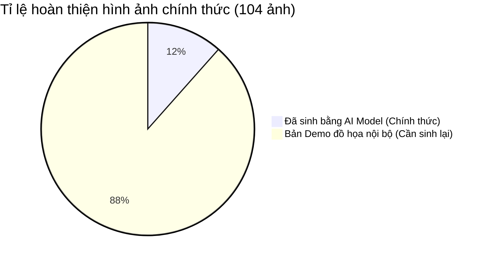

# BẢNG THEO DÕI TIẾN TRÌNH HÌNH ẢNH HỒ SƠ VỤ ÁN
## (IMAGE GENERATION AUDIT & PRODUCTION TRACKER)

> [!IMPORTANT]
> **Mục đích tài liệu:** Phân loại rõ ràng toàn bộ 104 hình ảnh trong hệ thống game phá án: đâu là hình ảnh **CHÍNH THỨC** (đã sinh bằng AI Image Model) và đâu là hình ảnh **DEMO** (đồ họa dựng tạm nội bộ đang chờ tạo lại bằng AI model). Dùng làm cơ sở dữ liệu để kích hoạt sinh ảnh tự động khi quota hồi phục.

---

## 📊 TỔNG QUAN TIẾN ĐỘ

- **Tổng số hình ảnh trong toàn bộ hệ thống:** **104** tệp (.webp)
- **Đã hoàn thiện CHÍNH THỨC bằng Model AI:** **12 / 104** (11%)
- **Bản DEMO đồ họa nội bộ (Cần sinh lại bằng Model AI):** **92 / 104** (88%)

---

## 📋 CHI TIẾT THEO TỪNG VỤ ÁN (17 CASES)

### Vụ án: Chiếc đồng hồ ở ngõ Gác Chuông (`demo-01`)
| STT | Hạng mục ảnh | Tên file | Kích thước | Trạng thái hiện tại | Chi tiết / Nguồn gốc |
| :--- | :--- | :--- | :--- | :--- | :--- |
| 1 | Ảnh bìa hộp (3:4) | `cover.webp` | 2518 KB | 🟡 *DEMO (Cần tạo lại)* | Đồ họa nội bộ • Prompt: [image-prompts.md#L15](file:///Users/huynguyen/Documents/game_pha_an/authoring/demo-01/image-prompts.md#L15) |
| 2 | Tài liệu d01 (Báo Phố Cũ: Trộm đột nhập nhà ...) | `d01-window.webp` | 67 KB | 🟡 *DEMO (Cần tạo lại)* | Đồ họa nội bộ • Prompt: [image-prompts.md#L34](file:///Users/huynguyen/Documents/game_pha_an/authoring/demo-01/image-prompts.md#L34) |
| 3 | Tài liệu d02 (Biên bản khám nghiệm hiện trườ...) | `d02-so-do-nha.webp` | 11 KB | 🟡 *DEMO (Cần tạo lại)* | Đồ họa nội bộ • Prompt: [image-prompts.md#L53](file:///Users/huynguyen/Documents/game_pha_an/authoring/demo-01/image-prompts.md#L53) |
| 4 | Tài liệu d07 (Ảnh trích xuất camera tiệm tạp...) | `d07-camera.webp` | 46 KB | 🟡 *DEMO (Cần tạo lại)* | Đồ họa nội bộ • Prompt: [image-prompts.md#L76](file:///Users/huynguyen/Documents/game_pha_an/authoring/demo-01/image-prompts.md#L76) |
| 5 | Tài liệu d08 (Phiếu cầm đồ thu giữ tại tiệm ...) | `d08-watch.webp` | 75 KB | 🟡 *DEMO (Cần tạo lại)* | Đồ họa nội bộ • Prompt: [image-prompts.md#L95](file:///Users/huynguyen/Documents/game_pha_an/authoring/demo-01/image-prompts.md#L95) |

### Vụ án: Con nước Rằm tháng Giêng (`con-nuoc-ram-thang-gieng`)
| STT | Hạng mục ảnh | Tên file | Kích thước | Trạng thái hiện tại | Chi tiết / Nguồn gốc |
| :--- | :--- | :--- | :--- | :--- | :--- |
| 1 | Ảnh bìa hộp (3:4) | `cover.webp` | 2456 KB | 🟡 *DEMO (Cần tạo lại)* | Đồ họa nội bộ • Prompt: [image-prompts.md#L15](file:///Users/huynguyen/Documents/game_pha_an/authoring/con-nuoc-ram-thang-gieng/image-prompts.md#L15) |
| 2 | Tài liệu d01 (Báo Đồng Khởi Mới: Cái chết bí...) | `d01-newspaper.webp` | 3802 KB | 🟡 *DEMO (Cần tạo lại)* | Đồ họa nội bộ • Prompt: [image-prompts.md#L34](file:///Users/huynguyen/Documents/game_pha_an/authoring/con-nuoc-ram-thang-gieng/image-prompts.md#L34) |
| 3 | Tài liệu d02 (Biên bản khám nghiệm hiện trườ...) | `d02-ban-do-song.webp` | 3101 KB | 🟡 *DEMO (Cần tạo lại)* | Đồ họa nội bộ • Prompt: [image-prompts.md#L53](file:///Users/huynguyen/Documents/game_pha_an/authoring/con-nuoc-ram-thang-gieng/image-prompts.md#L53) |
| 4 | Tài liệu d03 (Ảnh hiện trường: Then cài mặt ...) | `d03-then-cai.webp` | 53 KB | 🟡 *DEMO (Cần tạo lại)* | Đồ họa nội bộ • Prompt: [image-prompts.md#L78](file:///Users/huynguyen/Documents/game_pha_an/authoring/con-nuoc-ram-thang-gieng/image-prompts.md#L78) |
| 5 | Tài liệu d04 (Ảnh hiện trường: Chiếc ghe Phư...) | `d04-boat.webp` | 3207 KB | 🟡 *DEMO (Cần tạo lại)* | Đồ họa nội bộ • Prompt: [image-prompts.md#L97](file:///Users/huynguyen/Documents/game_pha_an/authoring/con-nuoc-ram-thang-gieng/image-prompts.md#L97) |
| 6 | Tài liệu d05 (Bản kết luận giám định pháp y ...) | `d05-giai-phau.webp` | 3029 KB | 🟡 *DEMO (Cần tạo lại)* | Đồ họa nội bộ • Prompt: [image-prompts.md#L116](file:///Users/huynguyen/Documents/game_pha_an/authoring/con-nuoc-ram-thang-gieng/image-prompts.md#L116) |
| 7 | Tài liệu d11 (Phiếu giám định dấu vết cơ học...) | `d10-valve.webp` | 369 KB | 🟡 *DEMO (Cần tạo lại)* | Đồ họa nội bộ • Prompt: [image-prompts.md#L139](file:///Users/huynguyen/Documents/game_pha_an/authoring/con-nuoc-ram-thang-gieng/image-prompts.md#L139) |
| 8 | Tài liệu d26 (Biên bản khám xét khẩn cấp chò...) | `d16-tools.webp` | 177 KB | 🟡 *DEMO (Cần tạo lại)* | Đồ họa nội bộ • Prompt: [image-prompts.md#L160](file:///Users/huynguyen/Documents/game_pha_an/authoring/con-nuoc-ram-thang-gieng/image-prompts.md#L160) |

### Vụ án: Mùa đông năm Bính Tý (`mua-dong-binh-ty`)
| STT | Hạng mục ảnh | Tên file | Kích thước | Trạng thái hiện tại | Chi tiết / Nguồn gốc |
| :--- | :--- | :--- | :--- | :--- | :--- |
| 1 | Ảnh bìa hộp (3:4) | `cover.webp` | 2702 KB | 🟡 *DEMO (Cần tạo lại)* | Đồ họa nội bộ • Prompt: [image-prompts.md#L15](file:///Users/huynguyen/Documents/game_pha_an/authoring/mua-dong-binh-ty/image-prompts.md#L15) |
| 2 | Tài liệu d01 (Báo Thủ Đô Cuối Tuần: Án mạng ...) | `d01-newspaper.webp` | 3395 KB | 🟡 *DEMO (Cần tạo lại)* | Đồ họa nội bộ • Prompt: [image-prompts.md#L34](file:///Users/huynguyen/Documents/game_pha_an/authoring/mua-dong-binh-ty/image-prompts.md#L34) |
| 3 | Tài liệu d02 (Biên bản khám nghiệm hiện trườ...) | `d02-so-do-can-ho.webp` | 72 KB | 🟡 *DEMO (Cần tạo lại)* | Đồ họa nội bộ • Prompt: [image-prompts.md#L53](file:///Users/huynguyen/Documents/game_pha_an/authoring/mua-dong-binh-ty/image-prompts.md#L53) |
| 4 | Tài liệu d04 (Ảnh hiện trường: Phòng 204 nhà...) | `d04-room.webp` | 60 KB | 🟡 *DEMO (Cần tạo lại)* | Đồ họa nội bộ • Prompt: [image-prompts.md#L76](file:///Users/huynguyen/Documents/game_pha_an/authoring/mua-dong-binh-ty/image-prompts.md#L76) |
| 5 | Tài liệu d06 (Biên bản giám định dấu vết cơ ...) | `d06-so-do-tu-thi.webp` | 66 KB | 🟡 *DEMO (Cần tạo lại)* | Đồ họa nội bộ • Prompt: [image-prompts.md#L95](file:///Users/huynguyen/Documents/game_pha_an/authoring/mua-dong-binh-ty/image-prompts.md#L95) |
| 6 | Tài liệu d12 (Phiếu giám định dược chất bình...) | `d12-inhaler.webp` | 50 KB | 🟡 *DEMO (Cần tạo lại)* | Đồ họa nội bộ • Prompt: [image-prompts.md#L118](file:///Users/huynguyen/Documents/game_pha_an/authoring/mua-dong-binh-ty/image-prompts.md#L118) |
| 7 | Tài liệu d16 (Ảnh tang vật: Đôi dép rọ bộ độ...) | `d16-shoes.webp` | 76 KB | 🟡 *DEMO (Cần tạo lại)* | Đồ họa nội bộ • Prompt: [image-prompts.md#L140](file:///Users/huynguyen/Documents/game_pha_an/authoring/mua-dong-binh-ty/image-prompts.md#L140) |
| 8 | Tài liệu d17 (Biên bản khám xét khẩn cấp thu...) | `d17-gold.webp` | 69 KB | 🟡 *DEMO (Cần tạo lại)* | Đồ họa nội bộ • Prompt: [image-prompts.md#L161](file:///Users/huynguyen/Documents/game_pha_an/authoring/mua-dong-binh-ty/image-prompts.md#L161) |

### Vụ án: Tiếng đàn đáy Phố Hiến (`tieng-dan-day-pho-hien`)
| STT | Hạng mục ảnh | Tên file | Kích thước | Trạng thái hiện tại | Chi tiết / Nguồn gốc |
| :--- | :--- | :--- | :--- | :--- | :--- |
| 1 | Ảnh bìa hộp (3:4) | `cover.webp` | 160 KB | 🟢 **CHÍNH THỨC (AI Model)** | AI Image Generator |
| 2 | Tài liệu d01 (Báo Hải Hưng - Tin buồn trong ...) | `d01-bao-chi.webp` | 7 KB | 🟡 *DEMO (Cần tạo lại)* | Đồ họa nội bộ • Prompt: [image-prompts.md#L34](file:///Users/huynguyen/Documents/game_pha_an/authoring/tieng-dan-day-pho-hien/image-prompts.md#L34) |
| 3 | Tài liệu d03 (Sơ đồ mặt bằng đình Hoa Nguyệt...) | `d03-so-do-dinh.webp` | 10 KB | 🟡 *DEMO (Cần tạo lại)* | Đồ họa nội bộ • Prompt: [image-prompts.md#L53](file:///Users/huynguyen/Documents/game_pha_an/authoring/tieng-dan-day-pho-hien/image-prompts.md#L53) |
| 4 | Tài liệu d04 (Ảnh chụp cây đàn đáy và tráp g...) | `d04-dan-day.webp` | 19 KB | 🟡 *DEMO (Cần tạo lại)* | Đồ họa nội bộ • Prompt: [image-prompts.md#L77](file:///Users/huynguyen/Documents/game_pha_an/authoring/tieng-dan-day-pho-hien/image-prompts.md#L77) |
| 5 | Tài liệu d06 (Lời khai sơ bộ của đào nương N...) | `d06-anh-chan-dung.webp` | 16 KB | 🟡 *DEMO (Cần tạo lại)* | Đồ họa nội bộ • Prompt: [image-prompts.md#L96](file:///Users/huynguyen/Documents/game_pha_an/authoring/tieng-dan-day-pho-hien/image-prompts.md#L96) |
| 6 | Tài liệu d13 (Ảnh chụp tang vật: Khăn lụa và...) | `d13-khan-lua.webp` | 9 KB | 🟡 *DEMO (Cần tạo lại)* | Đồ họa nội bộ • Prompt: [image-prompts.md#L119](file:///Users/huynguyen/Documents/game_pha_an/authoring/tieng-dan-day-pho-hien/image-prompts.md#L119) |

### Vụ án: Sương mù Trại Mát (`suong-mu-trai-trai`)
| STT | Hạng mục ảnh | Tên file | Kích thước | Trạng thái hiện tại | Chi tiết / Nguồn gốc |
| :--- | :--- | :--- | :--- | :--- | :--- |
| 1 | Ảnh bìa hộp (3:4) | `cover.webp` | 165 KB | 🟢 **CHÍNH THỨC (AI Model)** | AI Image Generator |
| 2 | Tài liệu d01 (Báo Lâm Đồng - Án mạng bí ẩn t...) | `d01-bao-chi.webp` | 8 KB | 🟡 *DEMO (Cần tạo lại)* | Đồ họa nội bộ • Prompt: [image-prompts.md#L1](file:///Users/huynguyen/Documents/game_pha_an/authoring/suong-mu-trai-trai/image-prompts.md#L1) |
| 3 | Tài liệu d03 (Sơ đồ mặt bằng trang trại hoa ...) | `d03-so-do-trang-trai.webp` | 12 KB | 🟡 *DEMO (Cần tạo lại)* | Đồ họa nội bộ • Prompt: [image-prompts.md#L1](file:///Users/huynguyen/Documents/game_pha_an/authoring/suong-mu-trai-trai/image-prompts.md#L1) |
| 4 | Tài liệu d05 (Ảnh hiện trường dốc bìa thông ...) | `d05-hien-truong.webp` | 9 KB | 🟡 *DEMO (Cần tạo lại)* | Đồ họa nội bộ • Prompt: [image-prompts.md#L15](file:///Users/huynguyen/Documents/game_pha_an/authoring/suong-mu-trai-trai/image-prompts.md#L15) |
| 5 | Tài liệu d11 (Trích xuất đồng hồ đo điện và ...) | `d11-dong-ho-nhiet-do.webp` | 11 KB | 🟡 *DEMO (Cần tạo lại)* | Đồ họa nội bộ • Prompt: [image-prompts.md#L1](file:///Users/huynguyen/Documents/game_pha_an/authoring/suong-mu-trai-trai/image-prompts.md#L1) |
| 6 | Tài liệu d12 (Ảnh chụp kho lạnh số 2 và máy ...) | `d12-kho-lanh.webp` | 7 KB | 🟡 *DEMO (Cần tạo lại)* | Đồ họa nội bộ • Prompt: [image-prompts.md#L23](file:///Users/huynguyen/Documents/game_pha_an/authoring/suong-mu-trai-trai/image-prompts.md#L23) |

### Vụ án: Chuyến tàu đêm Mường Mán (`chuyen-tau-dem-muong-man`)
| STT | Hạng mục ảnh | Tên file | Kích thước | Trạng thái hiện tại | Chi tiết / Nguồn gốc |
| :--- | :--- | :--- | :--- | :--- | :--- |
| 1 | Ảnh bìa hộp (3:4) | `cover.webp` | 2247 KB | 🟢 **CHÍNH THỨC (AI Model)** | AI Image Generator |
| 2 | Tài liệu d01 (Báo Bình Thuận - Vụ án mạng ki...) | `d01-bao-chi.webp` | 12 KB | 🟡 *DEMO (Cần tạo lại)* | Đồ họa nội bộ • Prompt: [image-prompts.md#L1](file:///Users/huynguyen/Documents/game_pha_an/authoring/chuyen-tau-dem-muong-man/image-prompts.md#L1) |
| 3 | Tài liệu d03 (Sơ đồ mặt bằng toa xe số 6...) | `d03-so-do-toa-tau.webp` | 12 KB | 🟡 *DEMO (Cần tạo lại)* | Đồ họa nội bộ • Prompt: [image-prompts.md#L1](file:///Users/huynguyen/Documents/game_pha_an/authoring/chuyen-tau-dem-muong-man/image-prompts.md#L1) |
| 4 | Tài liệu d05 (Ảnh cận cảnh lẫy khóa trong và...) | `d05-cua-truot.webp` | 5 KB | 🟡 *DEMO (Cần tạo lại)* | Đồ họa nội bộ • Prompt: [image-prompts.md#L15](file:///Users/huynguyen/Documents/game_pha_an/authoring/chuyen-tau-dem-muong-man/image-prompts.md#L15) |
| 5 | Tài liệu d09 (Bảng phân bổ hành khách và kiể...) | `d09-ve-tau-se3.webp` | 17 KB | 🟡 *DEMO (Cần tạo lại)* | Đồ họa nội bộ • Prompt: [image-prompts.md#L1](file:///Users/huynguyen/Documents/game_pha_an/authoring/chuyen-tau-dem-muong-man/image-prompts.md#L1) |
| 6 | Tài liệu d12 (Ảnh tang vật cuộn cước và chiế...) | `d12-cuon-cuoc.webp` | 11 KB | 🟡 *DEMO (Cần tạo lại)* | Đồ họa nội bộ • Prompt: [image-prompts.md#L23](file:///Users/huynguyen/Documents/game_pha_an/authoring/chuyen-tau-dem-muong-man/image-prompts.md#L23) |

### Vụ án: Bóng nắng giếng Bá Lễ (`bong-nang-hoi-an`)
| STT | Hạng mục ảnh | Tên file | Kích thước | Trạng thái hiện tại | Chi tiết / Nguồn gốc |
| :--- | :--- | :--- | :--- | :--- | :--- |
| 1 | Ảnh bìa hộp (3:4) | `cover.webp` | 152 KB | 🟢 **CHÍNH THỨC (AI Model)** | AI Image Generator |
| 2 | Tài liệu d01 (Bản tin An ninh Quảng Nam - Tr...) | `d01-bao-chi.webp` | 9 KB | 🟡 *DEMO (Cần tạo lại)* | Đồ họa nội bộ • Prompt: [image-prompts.md#L1](file:///Users/huynguyen/Documents/game_pha_an/authoring/bong-nang-hoi-an/image-prompts.md#L1) |
| 3 | Tài liệu d03 (Ảnh chụp hiện trường quanh miệ...) | `d03-gieng-ba-le.webp` | 260 KB | 🟢 **CHÍNH THỨC (AI Model)** | AI Image Generator |
| 4 | Tài liệu d04 (Sơ đồ lối đi từ từ đường ra gi...) | `d04-so-do-tu-duong.webp` | 13 KB | 🟡 *DEMO (Cần tạo lại)* | Đồ họa nội bộ • Prompt: [image-prompts.md#L1](file:///Users/huynguyen/Documents/game_pha_an/authoring/bong-nang-hoi-an/image-prompts.md#L1) |
| 5 | Tài liệu d07 (Bức ảnh bằng chứng ngoại phạm ...) | `d07-anh-com-ga.webp` | 151 KB | 🟢 **CHÍNH THỨC (AI Model)** | AI Image Generator |

### Vụ án: Đêm lửa tàn Buôn Ea Kral (`lua-than-tay-nguyen`)
| STT | Hạng mục ảnh | Tên file | Kích thước | Trạng thái hiện tại | Chi tiết / Nguồn gốc |
| :--- | :--- | :--- | :--- | :--- | :--- |
| 1 | Ảnh bìa hộp (3:4) | `cover.webp` | 167 KB | 🟢 **CHÍNH THỨC (AI Model)** | AI Image Generator |
| 2 | Tài liệu d01 (Báo Đắk Lắk - Hỏa hoạn thương ...) | `d01-bao-chi.webp` | 8 KB | 🟡 *DEMO (Cần tạo lại)* | Đồ họa nội bộ • Prompt: [image-prompts.md#L1](file:///Users/huynguyen/Documents/game_pha_an/authoring/lua-than-tay-nguyen/image-prompts.md#L1) |
| 3 | Tài liệu d03 (Kết quả giám định tử thi già l...) | `d03-so-do-buon-lang.webp` | 10 KB | 🟡 *DEMO (Cần tạo lại)* | Đồ họa nội bộ • Prompt: [image-prompts.md#L1](file:///Users/huynguyen/Documents/game_pha_an/authoring/lua-than-tay-nguyen/image-prompts.md#L1) |
| 4 | Tài liệu d05 (Ảnh chụp chiếc xà gạc dính máu...) | `d05-xa-gac.webp` | 10 KB | 🟡 *DEMO (Cần tạo lại)* | Đồ họa nội bộ • Prompt: [image-prompts.md#L15](file:///Users/huynguyen/Documents/game_pha_an/authoring/lua-than-tay-nguyen/image-prompts.md#L15) |
| 5 | Tài liệu d06 (Lời khai của con nuôi Y Bang...) | `d06-anh-the.webp` | 14 KB | 🟡 *DEMO (Cần tạo lại)* | Đồ họa nội bộ • Prompt: [image-prompts.md#L1](file:///Users/huynguyen/Documents/game_pha_an/authoring/lua-than-tay-nguyen/image-prompts.md#L1) |
| 6 | Tài liệu d11 (Ảnh tang vật bẫy nhiệt: Đui đè...) | `d11-rui-dien.webp` | 6 KB | 🟡 *DEMO (Cần tạo lại)* | Đồ họa nội bộ • Prompt: [image-prompts.md#L23](file:///Users/huynguyen/Documents/game_pha_an/authoring/lua-than-tay-nguyen/image-prompts.md#L23) |

### Vụ án: Gác đèn Hòn Dáu (`gac-den-hon-dau`)
| STT | Hạng mục ảnh | Tên file | Kích thước | Trạng thái hiện tại | Chi tiết / Nguồn gốc |
| :--- | :--- | :--- | :--- | :--- | :--- |
| 1 | Ảnh bìa hộp (3:4) | `cover.webp` | 151 KB | 🟢 **CHÍNH THỨC (AI Model)** | AI Image Generator |
| 2 | Tài liệu d01 (Báo Hải Phòng - Tang thương tr...) | `d01-bao-chi.webp` | 11 KB | 🟡 *DEMO (Cần tạo lại)* | Đồ họa nội bộ • Prompt: [image-prompts.md#L1](file:///Users/huynguyen/Documents/game_pha_an/authoring/gac-den-hon-dau/image-prompts.md#L1) |
| 3 | Tài liệu d02 (Biên bản hiện trường chân vách...) | `d02-ban-do-dao.webp` | 18 KB | 🟡 *DEMO (Cần tạo lại)* | Đồ họa nội bộ • Prompt: [image-prompts.md#L1](file:///Users/huynguyen/Documents/game_pha_an/authoring/gac-den-hon-dau/image-prompts.md#L1) |
| 4 | Tài liệu d04 (Sơ đồ mặt bằng trạm hải đăng H...) | `d04-giai-phau.webp` | 13 KB | 🟡 *DEMO (Cần tạo lại)* | Đồ họa nội bộ • Prompt: [image-prompts.md#L1](file:///Users/huynguyen/Documents/game_pha_an/authoring/gac-den-hon-dau/image-prompts.md#L1) |
| 5 | Tài liệu d11 (Ảnh chụp thanh lưỡng kim nhiệt...) | `d11-may-phat.webp` | 9 KB | 🟡 *DEMO (Cần tạo lại)* | Đồ họa nội bộ • Prompt: [image-prompts.md#L15](file:///Users/huynguyen/Documents/game_pha_an/authoring/gac-den-hon-dau/image-prompts.md#L15) |
| 6 | Tài liệu d15 (Ảnh chiếc áo mưa dính máu và t...) | `d15-ao-mua.webp` | 12 KB | 🟡 *DEMO (Cần tạo lại)* | Đồ họa nội bộ • Prompt: [image-prompts.md#L23](file:///Users/huynguyen/Documents/game_pha_an/authoring/gac-den-hon-dau/image-prompts.md#L23) |

### Vụ án: Vàng bóng Chợ Lớn (`vang-bong-cho-lon`)
| STT | Hạng mục ảnh | Tên file | Kích thước | Trạng thái hiện tại | Chi tiết / Nguồn gốc |
| :--- | :--- | :--- | :--- | :--- | :--- |
| 1 | Ảnh bìa hộp (3:4) | `cover.webp` | 196 KB | 🟢 **CHÍNH THỨC (AI Model)** | AI Image Generator |
| 2 | Tài liệu d01 (Báo Sài Gòn Giải Phóng - Vụ cư...) | `d01-bao-chi.webp` | 12 KB | 🟡 *DEMO (Cần tạo lại)* | Đồ họa nội bộ • Prompt: [image-prompts.md#L1](file:///Users/huynguyen/Documents/game_pha_an/authoring/vang-bong-cho-lon/image-prompts.md#L1) |
| 3 | Tài liệu d04 (Sơ đồ mặt bằng tiệm vàng Vạn T...) | `d04-so-do-tiem-vang.webp` | 10 KB | 🟡 *DEMO (Cần tạo lại)* | Đồ họa nội bộ • Prompt: [image-prompts.md#L3](file:///Users/huynguyen/Documents/game_pha_an/authoring/vang-bong-cho-lon/image-prompts.md#L3) |
| 4 | Tài liệu d05 (Ảnh chụp cận cảnh núm xoay két...) | `d05-num-ket.webp` | 10 KB | 🟡 *DEMO (Cần tạo lại)* | Đồ họa nội bộ • Prompt: [image-prompts.md#L15](file:///Users/huynguyen/Documents/game_pha_an/authoring/vang-bong-cho-lon/image-prompts.md#L15) |
| 5 | Tài liệu d09 (Cuống vé ca nhạc rạp Hào Huê c...) | `d09-cuong-ve.webp` | 15 KB | 🟡 *DEMO (Cần tạo lại)* | Đồ họa nội bộ • Prompt: [image-prompts.md#L1](file:///Users/huynguyen/Documents/game_pha_an/authoring/vang-bong-cho-lon/image-prompts.md#L1) |
| 6 | Tài liệu d10 (Ảnh mảnh giấy ghi 24 hoán vị t...) | `d10-manh-giay.webp` | 10 KB | 🟡 *DEMO (Cần tạo lại)* | Đồ họa nội bộ • Prompt: [image-prompts.md#L23](file:///Users/huynguyen/Documents/game_pha_an/authoring/vang-bong-cho-lon/image-prompts.md#L23) |

### Vụ án: Tiếng hú cảng Vân Đồn (`tieng-huan-van-don`)
| STT | Hạng mục ảnh | Tên file | Kích thước | Trạng thái hiện tại | Chi tiết / Nguồn gốc |
| :--- | :--- | :--- | :--- | :--- | :--- |
| 1 | Ảnh bìa hộp (3:4) | `cover.webp` | 188 KB | 🟢 **CHÍNH THỨC (AI Model)** | AI Image Generator |
| 2 | Tài liệu d01 (Báo Quảng Ninh - Vụ án mạng kỳ...) | `d01-bao-chi.webp` | 8 KB | 🟡 *DEMO (Cần tạo lại)* | Đồ họa nội bộ • Prompt: [image-prompts.md#L1](file:///Users/huynguyen/Documents/game_pha_an/authoring/tieng-huan-van-don/image-prompts.md#L1) |
| 3 | Tài liệu d03 (Kết quả giám định tử thi Thuyề...) | `d03-giai-phau.webp` | 14 KB | 🟡 *DEMO (Cần tạo lại)* | Đồ họa nội bộ • Prompt: [image-prompts.md#L18](file:///Users/huynguyen/Documents/game_pha_an/authoring/tieng-huan-van-don/image-prompts.md#L18) |
| 4 | Tài liệu d04 (Sơ đồ mặt bằng tàu đánh cá QN-...) | `d04-so-do-tau-ca.webp` | 13 KB | 🟡 *DEMO (Cần tạo lại)* | Đồ họa nội bộ • Prompt: [image-prompts.md#L1](file:///Users/huynguyen/Documents/game_pha_an/authoring/tieng-huan-van-don/image-prompts.md#L1) |
| 5 | Tài liệu d05 (Ảnh chụp cận cảnh nắp khoang l...) | `d05-nap-khoang.webp` | 5 KB | 🟡 *DEMO (Cần tạo lại)* | Đồ họa nội bộ • Prompt: [image-prompts.md#L15](file:///Users/huynguyen/Documents/game_pha_an/authoring/tieng-huan-van-don/image-prompts.md#L15) |
| 6 | Tài liệu d11 (Ảnh tang vật mẫu đá khô CO2 vi...) | `d11-da-kho.webp` | 9 KB | 🟡 *DEMO (Cần tạo lại)* | Đồ họa nội bộ • Prompt: [image-prompts.md#L23](file:///Users/huynguyen/Documents/game_pha_an/authoring/tieng-huan-van-don/image-prompts.md#L23) |

### Vụ án: Hồi chuông núi Sài Sơn (`hoi-chuong-chua-thay`)
| STT | Hạng mục ảnh | Tên file | Kích thước | Trạng thái hiện tại | Chi tiết / Nguồn gốc |
| :--- | :--- | :--- | :--- | :--- | :--- |
| 1 | Ảnh bìa hộp (3:4) | `cover.webp` | 37 KB | 🟡 *DEMO (Cần tạo lại)* | Đồ họa nội bộ • Prompt: [image-prompts.md#L7](file:///Users/huynguyen/Documents/game_pha_an/authoring/hoi-chuong-chua-thay/image-prompts.md#L7) |
| 2 | Tài liệu d01 (Báo Hà Tây - Vụ án mạng chấn đ...) | `d01-bao-chi.webp` | 11 KB | 🟡 *DEMO (Cần tạo lại)* | Đồ họa nội bộ • Prompt: [image-prompts.md#L1](file:///Users/huynguyen/Documents/game_pha_an/authoring/hoi-chuong-chua-thay/image-prompts.md#L1) |
| 3 | Tài liệu d03 (Kết quả giám định tử thi Đại đ...) | `d03-so-do-chua.webp` | 11 KB | 🟡 *DEMO (Cần tạo lại)* | Đồ họa nội bộ • Prompt: [image-prompts.md#L1](file:///Users/huynguyen/Documents/game_pha_an/authoring/hoi-chuong-chua-thay/image-prompts.md#L1) |
| 4 | Tài liệu d05 (Ảnh chụp gác chuông và hệ thốn...) | `d05-gac-chuong.webp` | 4 KB | 🟡 *DEMO (Cần tạo lại)* | Đồ họa nội bộ • Prompt: [image-prompts.md#L15](file:///Users/huynguyen/Documents/game_pha_an/authoring/hoi-chuong-chua-thay/image-prompts.md#L15) |
| 5 | Tài liệu d08 (Lời khai của phật tử làm bếp H...) | `d08-so-do-co-hoc.webp` | 9 KB | 🟡 *DEMO (Cần tạo lại)* | Đồ họa nội bộ • Prompt: [image-prompts.md#L3](file:///Users/huynguyen/Documents/game_pha_an/authoring/hoi-chuong-chua-thay/image-prompts.md#L3) |
| 6 | Tài liệu d11 (Ảnh tang vật ống bương tre trụ...) | `d11-ong-tre.webp` | 7 KB | 🟡 *DEMO (Cần tạo lại)* | Đồ họa nội bộ • Prompt: [image-prompts.md#L23](file:///Users/huynguyen/Documents/game_pha_an/authoring/hoi-chuong-chua-thay/image-prompts.md#L23) |

### Vụ án: Vết mực làng Đông Hồ (`vet-muc-lang-dong-ho`)
| STT | Hạng mục ảnh | Tên file | Kích thước | Trạng thái hiện tại | Chi tiết / Nguồn gốc |
| :--- | :--- | :--- | :--- | :--- | :--- |
| 1 | Ảnh bìa hộp (3:4) | `cover.webp` | 243 KB | 🟢 **CHÍNH THỨC (AI Model)** | AI Image Generator |
| 2 | Tài liệu d01 (Bản tin Văn hóa Bắc Ninh - Bản...) | `d01-bao-chi.webp` | 10 KB | 🟡 *DEMO (Cần tạo lại)* | Đồ họa nội bộ • Prompt: [image-prompts.md#L1](file:///Users/huynguyen/Documents/game_pha_an/authoring/vet-muc-lang-dong-ho/image-prompts.md#L1) |
| 3 | Tài liệu d03 (Ảnh chụp bản khắc gỗ thị bị đậ...) | `d03-ban-khac.webp` | 12 KB | 🟡 *DEMO (Cần tạo lại)* | Đồ họa nội bộ • Prompt: [image-prompts.md#L15](file:///Users/huynguyen/Documents/game_pha_an/authoring/vet-muc-lang-dong-ho/image-prompts.md#L15) |
| 4 | Tài liệu d04 (Sơ đồ làng tranh Đông Hồ và lố...) | `d04-so-do-lang-tranh.webp` | 15 KB | 🟡 *DEMO (Cần tạo lại)* | Đồ họa nội bộ • Prompt: [image-prompts.md#L1](file:///Users/huynguyen/Documents/game_pha_an/authoring/vet-muc-lang-dong-ho/image-prompts.md#L1) |
| 5 | Tài liệu d07 (Lời khai của thợ phụ Lê Văn Hù...) | `d07-tranh-dong-ho.webp` | 10 KB | 🟡 *DEMO (Cần tạo lại)* | Đồ họa nội bộ • Prompt: [image-prompts.md#L3](file:///Users/huynguyen/Documents/game_pha_an/authoring/vet-muc-lang-dong-ho/image-prompts.md#L3) |
| 6 | Tài liệu d10 (Ảnh dăm gỗ thị hình chóp lọng ...) | `d10-dam-go.webp` | 11 KB | 🟡 *DEMO (Cần tạo lại)* | Đồ họa nội bộ • Prompt: [image-prompts.md#L23](file:///Users/huynguyen/Documents/game_pha_an/authoring/vet-muc-lang-dong-ho/image-prompts.md#L23) |

### Vụ án: Ly trà tráo độc (`ly-tra-trao-doc`)
| STT | Hạng mục ảnh | Tên file | Kích thước | Trạng thái hiện tại | Chi tiết / Nguồn gốc |
| :--- | :--- | :--- | :--- | :--- | :--- |
| 1 | Ảnh bìa hộp (3:4) | `cover.webp` | 162 KB | 🟢 **CHÍNH THỨC (AI Model)** | AI Image Generator |
| 2 | Tài liệu d01 (Bản tin Thời sự - Vụ tử vong b...) | `d01-bao-chi.webp` | 10 KB | 🟡 *DEMO (Cần tạo lại)* | Đồ họa nội bộ • Prompt: [image-prompts.md#L1](file:///Users/huynguyen/Documents/game_pha_an/authoring/ly-tra-trao-doc/image-prompts.md#L1) |
| 3 | Tài liệu d03 (Kết quả giám định pháp y tử th...) | `d03-so-do-quan-tra.webp` | 12 KB | 🟡 *DEMO (Cần tạo lại)* | Đồ họa nội bộ • Prompt: [image-prompts.md#L1](file:///Users/huynguyen/Documents/game_pha_an/authoring/ly-tra-trao-doc/image-prompts.md#L1) |
| 4 | Tài liệu d05 (Ảnh chụp macro lỗ châm kim vi ...) | `d05-nap-coc.webp` | 9 KB | 🟡 *DEMO (Cần tạo lại)* | Đồ họa nội bộ • Prompt: [image-prompts.md#L18](file:///Users/huynguyen/Documents/game_pha_an/authoring/ly-tra-trao-doc/image-prompts.md#L18) |
| 5 | Tài liệu d07 (Lời khai của anh rể Nguyễn Mạn...) | `d07-hoa-don-tra-sua.webp` | 17 KB | 🟡 *DEMO (Cần tạo lại)* | Đồ họa nội bộ • Prompt: [image-prompts.md#L1](file:///Users/huynguyen/Documents/game_pha_an/authoring/ly-tra-trao-doc/image-prompts.md#L1) |
| 6 | Tài liệu d11 (Ảnh tang vật ống tiêm y tế và ...) | `d11-ong-tiem.webp` | 5 KB | 🟡 *DEMO (Cần tạo lại)* | Đồ họa nội bộ • Prompt: [image-prompts.md#L25](file:///Users/huynguyen/Documents/game_pha_an/authoring/ly-tra-trao-doc/image-prompts.md#L25) |

### Vụ án: Bức thư đêm tuyết trắng (`buc-thu-dem-tuyet-trang`)
| STT | Hạng mục ảnh | Tên file | Kích thước | Trạng thái hiện tại | Chi tiết / Nguồn gốc |
| :--- | :--- | :--- | :--- | :--- | :--- |
| 1 | Ảnh bìa hộp (3:4) | `cover.webp` | 37 KB | 🟡 *DEMO (Cần tạo lại)* | Đồ họa nội bộ • Prompt: [image-prompts.md#L7](file:///Users/huynguyen/Documents/game_pha_an/authoring/buc-thu-dem-tuyet-trang/image-prompts.md#L7) |
| 2 | Tài liệu d01 (Bản tin CNN - Bi kịch đêm Gián...) | `d01-bao-chi.webp` | 9 KB | 🟡 *DEMO (Cần tạo lại)* | Đồ họa nội bộ • Prompt: [image-prompts.md#L1](file:///Users/huynguyen/Documents/game_pha_an/authoring/buc-thu-dem-tuyet-trang/image-prompts.md#L1) |
| 3 | Tài liệu d04 (Sơ đồ mặt bằng biệt thự 15 phò...) | `d04-so-do-biet-thu.webp` | 12 KB | 🟡 *DEMO (Cần tạo lại)* | Đồ họa nội bộ • Prompt: [image-prompts.md#L1](file:///Users/huynguyen/Documents/game_pha_an/authoring/buc-thu-dem-tuyet-trang/image-prompts.md#L1) |
| 4 | Tài liệu d05 (Ảnh chụp bức thư tống tiền 3 t...) | `d05-buc-thu.webp` | 7 KB | 🟡 *DEMO (Cần tạo lại)* | Đồ họa nội bộ • Prompt: [image-prompts.md#L18](file:///Users/huynguyen/Documents/game_pha_an/authoring/buc-thu-dem-tuyet-trang/image-prompts.md#L18) |
| 5 | Tài liệu d07 (Lời khai của người cha John Ra...) | `d07-anh-hoa-khoi.webp` | 16 KB | 🟡 *DEMO (Cần tạo lại)* | Đồ họa nội bộ • Prompt: [image-prompts.md#L10](file:///Users/huynguyen/Documents/game_pha_an/authoring/buc-thu-dem-tuyet-trang/image-prompts.md#L10) |
| 6 | Tài liệu d11 (Ảnh phân tích vi thể sợi len á...) | `d11-soi-len.webp` | 26 KB | 🟡 *DEMO (Cần tạo lại)* | Đồ họa nội bộ • Prompt: [image-prompts.md#L25](file:///Users/huynguyen/Documents/game_pha_an/authoring/buc-thu-dem-tuyet-trang/image-prompts.md#L25) |

### Vụ án: Đêm súng nổ phố Tây Sơn (`dem-sung-no-tay-son`)
| STT | Hạng mục ảnh | Tên file | Kích thước | Trạng thái hiện tại | Chi tiết / Nguồn gốc |
| :--- | :--- | :--- | :--- | :--- | :--- |
| 1 | Ảnh bìa hộp (3:4) | `cover.webp` | 37 KB | 🟡 *DEMO (Cần tạo lại)* | Đồ họa nội bộ • Prompt: [image-prompts.md#L7](file:///Users/huynguyen/Documents/game_pha_an/authoring/dem-sung-no-tay-son/image-prompts.md#L7) |
| 2 | Tài liệu d01 (Báo An ninh Thủ đô - Trọng án ...) | `d01-bao-chi.webp` | 9 KB | 🟡 *DEMO (Cần tạo lại)* | Đồ họa nội bộ • Prompt: [image-prompts.md#L1](file:///Users/huynguyen/Documents/game_pha_an/authoring/dem-sung-no-tay-son/image-prompts.md#L1) |
| 3 | Tài liệu d04 (Sơ đồ hiện trường tiệm vàng và...) | `d04-so-do-hien-truong.webp` | 11 KB | 🟡 *DEMO (Cần tạo lại)* | Đồ họa nội bộ • Prompt: [image-prompts.md#L10](file:///Users/huynguyen/Documents/game_pha_an/authoring/dem-sung-no-tay-son/image-prompts.md#L10) |
| 4 | Tài liệu d05 (Ảnh chụp 3 vỏ đạn K54 dập năm ...) | `d05-vo-dan.webp` | 10 KB | 🟡 *DEMO (Cần tạo lại)* | Đồ họa nội bộ • Prompt: [image-prompts.md#L18](file:///Users/huynguyen/Documents/game_pha_an/authoring/dem-sung-no-tay-son/image-prompts.md#L18) |
| 5 | Tài liệu d11 (Ảnh dấu vân tay trên vỏ bao th...) | `d11-bao-thuoc.webp` | 9 KB | 🟡 *DEMO (Cần tạo lại)* | Đồ họa nội bộ • Prompt: [image-prompts.md#L25](file:///Users/huynguyen/Documents/game_pha_an/authoring/dem-sung-no-tay-son/image-prompts.md#L25) |
| 6 | Tài liệu d12 (Biên bản xác minh bến phà Đen...) | `d12-ve-pha-den.webp` | 15 KB | 🟡 *DEMO (Cần tạo lại)* | Đồ họa nội bộ • Prompt: [image-prompts.md#L26](file:///Users/huynguyen/Documents/game_pha_an/authoring/dem-sung-no-tay-son/image-prompts.md#L26) |

### Vụ án: Quái vật 21 khuôn mặt (`quai-vat-21-khuon-mat`)
| STT | Hạng mục ảnh | Tên file | Kích thước | Trạng thái hiện tại | Chi tiết / Nguồn gốc |
| :--- | :--- | :--- | :--- | :--- | :--- |
| 1 | Ảnh bìa hộp (3:4) | `cover.webp` | 1795 KB | 🟡 *DEMO (Cần tạo lại)* | Đồ họa nội bộ • Prompt: [image-prompts.md#L13](file:///Users/huynguyen/Documents/game_pha_an/authoring/quai-vat-21-khuon-mat/image-prompts.md#L13) |
| 2 | Tài liệu d01 (Báo Asahi Shimbun - Cơn ác mộn...) | `d01-bao-chi.webp` | 2764 KB | 🟡 *DEMO (Cần tạo lại)* | Đồ họa nội bộ • Prompt: [image-prompts.md#L32](file:///Users/huynguyen/Documents/game_pha_an/authoring/quai-vat-21-khuon-mat/image-prompts.md#L32) |
| 3 | Tài liệu d05 (Ảnh chụp bức thư nặc danh máy ...) | `d05-buc-thu.webp` | 2005 KB | 🟡 *DEMO (Cần tạo lại)* | Đồ họa nội bộ • Prompt: [image-prompts.md#L51](file:///Users/huynguyen/Documents/game_pha_an/authoring/quai-vat-21-khuon-mat/image-prompts.md#L51) |
| 4 | Tài liệu d08 (Bức thư thứ 14 của Quái vật 21...) | `d08-phac-hoa-mat-cao.webp` | 64 KB | 🟡 *DEMO (Cần tạo lại)* | Đồ họa nội bộ • Prompt: [image-prompts.md#L70](file:///Users/huynguyen/Documents/game_pha_an/authoring/quai-vat-21-khuon-mat/image-prompts.md#L70) |
| 5 | Tài liệu d11 (Ảnh chụp vi thể mép dán keo nh...) | `d11-hop-keo.webp` | 2006 KB | 🟡 *DEMO (Cần tạo lại)* | Đồ họa nội bộ • Prompt: [image-prompts.md#L89](file:///Users/huynguyen/Documents/game_pha_an/authoring/quai-vat-21-khuon-mat/image-prompts.md#L89) |
| 6 | Tài liệu d15 (Biểu đồ biến động cổ phiếu bất...) | `d15-bieu-do-co-phieu.webp` | 8538 KB | 🟡 *DEMO (Cần tạo lại)* | Đồ họa nội bộ • Prompt: [image-prompts.md#L108](file:///Users/huynguyen/Documents/game_pha_an/authoring/quai-vat-21-khuon-mat/image-prompts.md#L108) |
