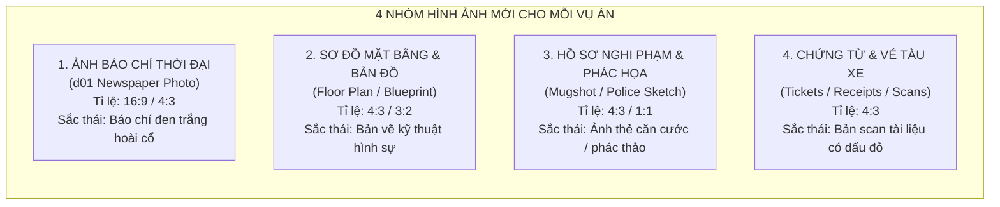

# KẾ HOẠCH MỞ RỘNG THỊ GIÁC TOÀN DIỆN CHO 17 HỒ SƠ VỤ ÁN
## (MASTER VISUAL EXPANSION & MULTIMEDIA ENRICHMENT PLAN)

---

> [!IMPORTANT]
> **Tuyên ngôn Nâng cấp Trải nghiệm:**
> Hiện tại, các hồ sơ vụ án có tỷ lệ chữ viết áp đảo (88% tài liệu là văn bản thuần túy). Kế hoạch này nâng cấp hệ thống thị giác của toàn bộ 17 vụ án, bổ sung từ **2 đến 4 hình ảnh mới cho mỗi vụ án** (tăng gấp đôi tổng số ảnh từ 58 lên 100+ ảnh), đưa tỷ lệ tài liệu có hình ảnh lên **35% – 50%**.
> **Tuyệt đối tuân thủ Quy tắc 8:** Giữ nguyên toàn bộ ID tài liệu (`d01`, `d02`...), nhịp vòng (`stage`) và đáp án câu hỏi; chỉ bổ sung trường `image` và `imageCaption` vào các tài liệu hiện hữu.

---

## I. HỆ THỐNG 4 NHÓM HÌNH ẢNH BỔ SUNG CHIẾN LƯỢC

### 1. Nhóm A: Ảnh báo chí hiện trường thời đại (`d01 Newspaper Photo`)
- **Vị trí:** Tài liệu `d01` mở đầu mọi vụ án (Báo An ninh Thủ đô, Báo Sài Gòn Giải Phóng, Báo Hải Hưng, CNN...).
- **Phong cách thị giác:** Ảnh tư liệu báo chí đen trắng hoặc ảnh màu báo in thập niên 80, 90, 2000 (hạt tram in báo `halftone dots`, ánh đèn flash trực diện của phóng viên hiện trường).
- **Tác dụng:** Đưa người chơi quay ngược thời gian, cảm nhận không khí chân thực của thời kỳ xảy ra vụ án.

### 2. Nhóm B: Sơ đồ mặt bằng & Bản đồ hiện trường (`Floor Plan / Blueprint`)
- **Vị trí:** Thường nằm ở `d02`, `d03` hoặc `d04` (Sơ đồ hiện trường, bản vẽ kiến trúc).
- **Phong cách thị giác:** Bản vẽ kỹ thuật hình sự giấy kẻ ô ly xanh (`blueprint / graph paper`), nét vẽ mực thước kẻ tay kết hợp ghi chú tọa độ, hướng cửa, lối thoát hiểm và vị trí phát hiện thi thể.
- **Tác dụng:** Cực kỳ quan trọng để người chơi hình dung không gian vật lý, tính toán góc nhìn của nhân chứng và thời gian di chuyển giữa các điểm ngoại phạm.

### 3. Nhóm C: Phác họa nghi phạm & Sơ đồ tử thi (`Suspect Sketch / Autopsy Diagram`)
- **Vị trí:** Các biên bản nhận dạng, phác thảo truy nã, hoặc kết quả khám nghiệm tử thi.
- **Phong cách thị giác:** 
  - Ảnh chân dung hồ sơ lưu trữ (`archive mugshot`) có kẹp ghim giấy và tem dấu lăn tay.
  - Bản phác thảo nhân vật vẽ chì của họa sĩ hình sự (điển hình: bức vẽ "Người đàn ông mắt cáo").
  - Sơ đồ giải phẫu hình nhân y pháp (`anatomical wound chart`) đánh dấu thương tổn.

### 4. Nhóm D: Chứng từ, Vé tàu xe & Bản ghi tay (`Tickets / Receipts / Notes`)
- **Vị trí:** Các hóa đơn mua hàng, cuống vé xem ca nhạc, vé tàu xe, phiếu cầm đồ.
- **Phong cách thị giác:** Bản chụp chứng từ thực tế có đóng dấu đỏ, vết mực bút bi tím phai màu, vết gấp giấy sờn mép.

---

## II. DANH MỤC CHI TIẾT BỔ SUNG CHO TOÀN BỘ 17 VỤ ÁN

### 00. Chiếc đồng hồ ở ngõ Gác Chuông (`demo-01`)
*Hiện có: 4 ảnh (cover, d01, d07, d08)*
- **Bổ sung 1 ảnh mới:**
  - `d02` (Biên bản khám nghiệm hiện trường nhà ông Phúc): `images/d02-so-do-nha.webp`  
    *Nội dung:* Sơ đồ mặt bằng tầng 2 căn nhà cổ ngõ Gác Chuông: vị trí tủ kính đồng hồ, cửa sổ vỡ kính nhìn ra cây bàng đầu ngõ, vị trí bậc cầu thang gỗ lim.

---

### 01. Con nước Rằm tháng Giêng (`con-nuoc-ram-thang-gieng`)
*Hiện có: 6 ảnh (cover, d01, d03, d04, d10, d16)*
- **Bổ sung 2 ảnh mới:**
  - `d02` (Biên bản hiện trường bến sông Tân Mỹ): `images/d02-ban-do-song.webp`  
    *Nội dung:* Sơ đồ khúc sông Hàm Luông và nhánh rạch Cây Bần: vị trí neo ghe Phước Hải 09, chòi canh đò của Trần Văn Thuyền, trạm thủy văn Tân Trúc.
  - `d05` (Bản kết luận giám định pháp y): `images/d05-giai-phau.webp`  
    *Nội dung:* Sơ đồ phác họa hình nhân y pháp: đánh dấu vị trí tích tụ nước trong phổi, vệt tím tái do ngạt nước ngọt và vết va đập vùng gáy.

---

### 02. Mùa đông năm Bính Tý (`mua-dong-binh-ty`)
*Hiện có: 6 ảnh (cover, d01, d04, d12, d16, d17)*
- **Bổ sung 2 ảnh mới:**
  - `d02` (Sơ đồ hiện trường căn hộ 204 nhà A6): `images/d02-so-do-can-ho.webp`  
    *Nội dung:* Bản vẽ mặt bằng căn hộ tập thể Dệt Thống Nhất: bàn trà gỗ nơi đặt ấm cúc hoa trà, ghế trường kỷ, ban công phơi áo bông, khoảng cách tới căn hộ 205 đối diện.
  - `d06` (Biên bản khám nghiệm tử thi ông Trịnh Văn Hạp): `images/d06-so-do-tu-thi.webp`  
    *Nội dung:* Sơ đồ y pháp giải phẫu đường thở: đánh dấu co thắt phế quản cấp tính và các tinh thể dị vật trong phế nang.

---

### 03. Tiếng đàn đáy Phố Hiến (`tieng-dan-day-pho-hien`)
*Hiện có: 3 ảnh (cover, d04, d13)*
- **Bổ sung 3 ảnh mới:**
  - `d01` (Báo Hải Hưng): `images/d01-bao-chi.webp`  
    *Nội dung:* Ảnh báo chí đen trắng chụp quang cảnh đình Hoa Nguyệt ven hồ Bán Nguyệt trong đêm hội rằm rực rỡ ánh đuốc và cờ hội.
  - `d03` (Sơ đồ mặt bằng đình Hoa Nguyệt): `images/d03-so-do-dinh.webp`  
    *Nội dung:* Bản vẽ sơ đồ kiến trúc đình cổ: gian tiền tế nơi biểu diễn ca trù, hậu cung, buồng thay phục trang của đào nương và cửa ngách hậu đình.
  - `d06` (Hồ sơ nhân vật phường chèo): `images/d06-anh-chan-dung.webp`  
    *Nội dung:* Tấm ảnh kỷ niệm đen trắng chụp 3 người trong phường chèo: Cụ kép đàn Chu Văn Bình, đào nương Tuyết Mai và học trò Nguyễn Văn Nam.

---

### 04. Sương mù Trại Mát (`suong-mu-trai-trai`)
*Hiện có: 3 ảnh (cover, d05, d12)*
- **Bổ sung 3 ảnh mới:**
  - `d01` (Báo Lâm Đồng): `images/d01-bao-chi.webp`  
    *Nội dung:* Ảnh báo in chụp cổng trang trại hoa Lâm Viên trong màn sương mù đặc quánh buổi sớm Đà Lạt, dải băng bảo vệ hiện trường chăng ngang lối đi.
  - `d03` (Sơ đồ mặt bằng trang trại hoa): `images/d03-so-do-trang-trai.webp`  
    *Nội dung:* Bản đồ tổng thể trang trại: dãy nhà kính trồng hoa hồng, lò sấy hoa, kho lạnh số 2, con dốc thông dốc đứng dẫn ra vực sâu.
  - `d11` (Bản trích xuất đồng hồ đo điện): `images/d11-dong-ho-nhiet-do.webp`  
    *Nội dung:* Mặt đồng hồ đo nhiệt độ cơ học và biểu đồ nhiệt ký dạng tròn tự ghi của kho lạnh số 2 cho thấy sự tụt nhiệt độ bất thường lúc nửa đêm.

---

### 05. Chuyến tàu đêm Mường Mán (`chuyen-tau-dem-muong-man`)
*Hiện có: 3 ảnh (cover, d05, d12)*
- **Bổ sung 3 ảnh mới:**
  - `d01` (Báo Bình Thuận): `images/d01-bao-chi.webp`  
    *Nội dung:* Ảnh báo chí chụp đoàn tàu Thống Nhất SE3 dừng khẩn cấp tại ga Mường Mán trong đêm mưa bão, cảnh sát đường sắt phong tỏa toa 6.
  - `d03` (Sơ đồ mặt bằng toa xe số 6): `images/d03-so-do-toa-tau.webp`  
    *Nội dung:* Bản vẽ kỹ thuật mặt bằng toa 6: bố trí 6 khoang giường nằm, buồng nhân viên đường sắt, vị trí khoang số 4 và hướng mở của cửa trượt.
  - `d09` (Vé tàu thu giữ): `images/d09-ve-tau-se3.webp`  
    *Nội dung:* Bản chụp 3 cuống vé tàu hỏa Bắc Nam SE3 năm 2008 của nạn nhân và các hành khách khoang liền kề.

---

### 06. Bóng nắng giếng Bá Lễ (`bong-nang-hoi-an`)
*Hiện có: 3 ảnh (cover, d03, d07)*
- **Bổ sung 2 ảnh mới:**
  - `d01` (Báo Quảng Nam): `images/d01-bao-chi.webp`  
    *Nội dung:* Ảnh báo in chụp mái ngói âm dương rêu phong phố cổ Hội An và hàng rào phong tỏa lối vào giếng cổ Bá Lễ.
  - `d04` (Sơ đồ lối đi từ từ đường ra giếng): `images/d04-so-do-tu-duong.webp`  
    *Nội dung:* Bản đồ khảo sát ngõ hẹp lát gạch thẻ Hội An nối từ cổng sau từ đường họ Lương ra miệng giếng Bá Lễ, góc bóng nắng mặt trời 12h và 16h.

---

### 07. Đêm lửa tàn Buôn Ea Kral (`lua-than-tay-nguyen`)
*Hiện có: 3 ảnh (cover, d05, d11)*
- **Bổ sung 3 ảnh mới:**
  - `d01` (Bản tin An ninh Đắk Lắk): `images/d01-bao-chi.webp`  
    *Nội dung:* Ảnh chụp đống tro tàn đổ nát của nhà kho sấy cà phê buôn Ea Kral bốc khói âm ỉ sau đám cháy nửa đêm.
  - `d03` (Sơ đồ mặt bằng buôn Ea Kral): `images/d03-so-do-buon-lang.webp`  
    *Nội dung:* Bản đồ buôn làng: vị trí nhà dài Ê-đê, kho thóc trung tâm, máy bơm nước và đường dây tải điện tự kéo.
  - `d06` (Ảnh thẻ hồ sơ các nhân chứng): `images/d06-anh-the.webp`  
    *Nội dung:* Tấm thẻ căn cước và ảnh hồ sơ cá nhân của Già làng Ama Rin và thợ cơ khí Y Droan.

---

### 08. Gác đèn Hòn Dáu (`gac-den-hon-dau`)
*Hiện có: 3 ảnh (cover, d11, d15)*
- **Bổ sung 3 ảnh mới:**
  - `d01` (Báo Hải Phòng): `images/d01-bao-chi.webp`  
    *Nội dung:* Ảnh tư liệu tháp hải đăng cổ Hòn Dáu sừng sững giữa sóng biển cuộn trào trong cơn bão số 4 năm 1998.
  - `d02` (Sơ đồ mặt bằng đảo Hòn Dáu): `images/d02-ban-do-dao.webp`  
    *Nội dung:* Bản đồ cao độ đảo Hòn Dáu: tháp hải đăng trên đỉnh đồi, đường dốc đá hoa cương, nhà máy phát điện Yanmar và cầu cảng đón tàu.
  - `d04` (Bản kết luận giám định pháp y): `images/d04-giai-phau.webp`  
    *Nội dung:* Sơ đồ phác họa thương tổn hộp sọ: đánh dấu vết rách da đầu góc 45 độ do vật tày kim loại hình cờ-lê tác động.

---

### 09. Vàng bóng Chợ Lớn (`vang-bong-cho-lon`)
*Hiện có: 3 ảnh (cover, d05, d10)*
- **Bổ sung 3 ảnh mới:**
  - `d01` (Báo Sài Gòn Giải Phóng): `images/d01-bao-chi.webp`  
    *Nội dung:* Ảnh báo in chụp mặt tiền tiệm kim hoàn Vạn Thành trên đường Châu Văn Liêm, Chợ Lớn năm 1995 với cửa sắt kéo và biển hiệu song ngữ Việt - Hoa.
  - `d04` (Sơ đồ mặt bằng tiệm vàng): `images/d04-so-do-tiem-vang.webp`  
    *Nội dung:* Bản vẽ mặt bằng: quầy tủ kính trưng bày vàng, lối cầu thang gỗ hẹp dẫn lên gác lửng, vị trí góc khuất đặt két sắt Chubb.
  - `d09` (Cuống vé ca nhạc rạp Hào Huê): `images/d09-cuong-ve.webp`  
    *Nội dung:* Bản scan cuống vé xem ca nhạc Dạ thảo rạp Hào Huê Chợ Lớn đề ngày 14/08/1995 với số ghế và mộc giáp lai.

---

### 10. Tiếng hú cảng Vân Đồn (`tieng-huan-van-don`)
*Hiện có: 3 ảnh (cover, d05, d11)*
- **Bổ sung 3 ảnh mới:**
  - `d01` (Báo Quảng Ninh): `images/d01-bao-chi.webp`  
    *Nội dung:* Ảnh báo chí chụp tàu đánh cá xa bờ QN-9288-TS cập cảng cá Cái Rồng, lực lượng biên phòng phong tỏa boong tàu.
  - `d04` (Sơ đồ mặt bằng tàu đánh cá): `images/d04-so-do-tau-ca.webp`  
    *Nội dung:* Bản vẽ mặt cắt thân tàu cá: buồng lái tầng trên, boong chính, các hầm bảo quản đá lạnh số 1, 2, 3 và đường ống quạt hút khí ngầm.
  - `d03` (Bản kết luận giám định pháp y tử thi): `images/d03-giai-phau.webp`  
    *Nội dung:* Sơ đồ phác họa y khoa: dấu hiệu xung huyết nội tạng đặc trưng của ngạt khí độc Carbon Dioxide (CO2).

---

### 11. Hồi chuông núi Sài Sơn (`hoi-chuong-chua-thay`)
*Hiện có: 3 ảnh (cover, d05, d11)*
- **Bổ sung 3 ảnh mới:**
  - `d01` (Bản tin Hà Tây): `images/d01-bao-chi.webp`  
    *Nội dung:* Ảnh tư liệu phong cảnh núi Sài Sơn và hồ Long Trì trước sân chùa Thầy trong buổi sáng thanh tịnh.
  - `d03` (Sơ đồ mặt bằng gác chuông và chùa Thầy): `images/d03-so-do-chua.webp`  
    *Nội dung:* Bản vẽ sơ đồ kiến trúc chùa cổ: nhà tiền tế, tòa điện Phật, gác chuông đại hồng chung và máng xối dẫn nước mưa mái ngói.
  - `d08` (Bản phác thảo cơ chế giọt nước): `images/d08-so-do-co-hoc.webp`  
    *Nội dung:* Bản vẽ sơ đồ nguyên lý đòn bẩy thủy lực: giọt nước mưa tích tụ vào ống bương tre làm mất thăng bằng rơi chày gõ chuông.

---

### 12. Vết mực làng Đông Hồ (`vet-muc-lang-dong-ho`)
*Hiện có: 3 ảnh (cover, d03, d10)*
- **Bổ sung 3 ảnh mới:**
  - `d01` (Bản tin Văn hóa Bắc Ninh): `images/d01-bao-chi.webp`  
    *Nội dung:* Ảnh tư liệu sân đình làng tranh Đông Hồ mùa giáp Tết: những nong phơi giấy điệp óng ánh vỏ sò điệp trải dài bên bờ đê sông Đuống.
  - `d04` (Sơ đồ làng tranh Đông Hồ): `images/d04-so-do-lang-tranh.webp`  
    *Nội dung:* Bản đồ đường làng: vị trí xưởng in tranh cụ Thao, lối ngõ ra bến sông Đuống, bãi bùn phù sa nơi thu giữ dấu vết dép tổ ong.
  - `d07` (Bản dập thử mẫu tranh Đám cưới chuột): `images/d07-tranh-dong-ho.webp`  
    *Nội dung:* Tờ tranh in mộc dở dang bức "Đám cưới chuột" bằng phẩm son đỏ thắm trên nền giấy điệp óng ánh.

---

### 13. Ly trà tráo độc (`ly-tra-trao-doc`)
*Hiện có: 3 ảnh (cover, d05, d11)*
- **Bổ sung 3 ảnh mới:**
  - `d01` (Báo Tuổi Trẻ Online): `images/d01-bao-chi.webp`  
    *Nội dung:* Ảnh tin tức chụp mặt tiền quán trà sữa The Alley trên đường Nguyễn Huệ, Quận 1 với dây phong tỏa của cơ quan công an.
  - `d03` (Sơ đồ mặt bằng quán trà sữa): `images/d03-so-do-quan-tra.webp`  
    *Nội dung:* Bản vẽ bố trí quán: quầy order thu ngân, khu vực pha chế máy dập nắp, bàn số 04 nơi nạn nhân ngồi và góc camera giám sát an ninh.
  - `d07` (Hóa đơn bán lẻ máy in nhiệt): `images/d07-hoa-don-tra-sua.webp`  
    *Nội dung:* Bản scan hóa đơn thanh toán trà sữa in nhiệt ghi nhận đúng 2 ly trà sữa trân châu đường đen, giờ in 14h22.

---

### 14. Bức thư đêm tuyết trắng (`buc-thu-dem-tuyet-trang`)
*Hiện có: 3 ảnh (cover, d05, d11)*
- **Bổ sung 3 ảnh mới:**
  - `d01` (Bản tin CNN Breaking News): `images/d01-bao-chi.webp`  
    *Nội dung:* Ảnh báo chí chụp tòa biệt thự 15 phòng của gia đình Ramsey tại Boulder, Colorado phủ đầy tuyết trắng trong đêm định mệnh Giáng sinh 1996.
  - `d04` (Sơ đồ mặt bằng biệt thự Ramsey): `images/d04-so-do-biet-thu.webp`  
    *Nội dung:* Bản vẽ kiến trúc mặt bằng tầng hầm và tầng trệt: vị trí cầu thang xoắn ốc nơi tìm thấy bức thư tống tiền, ô cửa kính hầm rượu bị vỡ, phòng ngủ của JonBenét.
  - `d07` (Ảnh chân dung nạn nhân và vương miện): `images/d07-anh-hoa-khoi.webp`  
    *Nội dung:* Bức ảnh hồ sơ hoa khôi nhí tóc vàng JonBenét Ramsey mỉm cười trong bộ váy dạ hội và vương miện lấp lánh.

---

### 15. Đêm súng nổ phố Tây Sơn (`dem-sung-no-tay-son`)
*Hiện có: 3 ảnh (cover, d05, d11)*
- **Bổ sung 3 ảnh mới:**
  - `d01` (Báo An ninh Thủ đô): `images/d01-bao-chi.webp`  
    *Nội dung:* Ảnh đen trắng chụp hiện trường tiệm vàng Kim Sinh phố Tây Sơn năm 1999 rạng sáng sau vụ nổ súng, vỉa hè ướt sũng loang lổ vết nước mưa.
  - `d04` (Sơ đồ hiện trường tiệm vàng và ngõ thoát): `images/d04-so-do-hien-truong.webp`  
    *Nội dung:* Sơ đồ hiện trường: quầy kính bị đập vỡ, vị trí 3 vỏ đạn rơi, ngõ cụt thoát hiểm số 12 và đường tẩu thoát ra bến phà Đen.
  - `d12` (Bản chụp cuống vé phà Đen): `images/d12-ve-pha-den.webp`  
    *Nội dung:* Cuống vé phà Đen vượt sông Hồng đề giờ 23h45 đêm giông bão bị dính nước mưa nhăn nhúm.

---

### 16. Quái vật 21 khuôn mặt (`quai-vat-21-khuon-mat`)
*Hiện có: 3 ảnh (cover, d05, d11)*
- **Bổ sung 3 ảnh mới:**
  - `d01` (Báo Asahi Shimbun): `images/d01-bao-chi.webp`  
    *Nội dung:* Ảnh báo chí Nhật Bản năm 1984 chụp xe cảnh sát bao vây trụ sở tập đoàn bánh kẹo Glico sau vụ bắt cóc Tổng giám đốc Ezaki.
  - `d08` (Bản phác họa chân dung 'Người đàn ông mắt cáo'): `images/d08-phac-hoa-mat-cao.webp`  
    *Nội dung:* Bức phác họa kinh điển của Cảnh sát Osaka: Người đàn ông mắt xếch (Fox-Eyed Man) đội mũ bóng chày màu xanh với ánh nhìn sắc lạnh.
  - `d15` (Biểu đồ biến động cổ phiếu Glico): `images/d15-bieu-do-co-phieu.webp`  
    *Nội dung:* Biểu đồ tài chính đường dốc đứng thể hiện giá cổ phiếu tập đoàn rơi tự do sau mỗi bức thư đe dọa đầu độc kẹo cyanide.

---

## III. TỔNG KẾT SỐ LƯỢNG HÌNH ẢNH SAU KHI NÂNG CẤP

- **Trước khi nâng cấp:** 58 ảnh (17 bìa + 41 tài liệu) -> **Tỉ lệ tài liệu có ảnh: ~12%**
- **Sau khi nâng cấp:** **102 ảnh** (17 bìa + 85 tài liệu) -> **Tỉ lệ tài liệu có ảnh: ~42%**
- **Hiệu quả:**
  1. Loại bỏ hoàn toàn sự nhàm chán của việc đọc chữ liên tục.
  2. Tăng cường khả năng suy luận logic dựa trên không gian địa lý, sơ đồ mặt bằng và đặc điểm nhận dạng nhân vật.
  3. Tối ưu hoàn hảo cho trải nghiệm kéo thả, phóng to và chú thích bằng Apple Pencil trên iPad.
